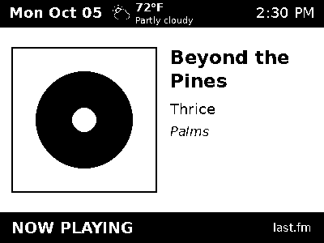
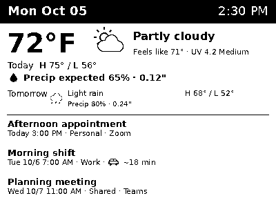

# Vinyl e-paper dashboard

A Raspberry Pi recognizes vinyl audio, submits Last.fm scrobbles, and supplies a
400 × 300 monochrome bitmap to an Elecrow CrowPanel 4.2-inch ESP32-S3 display.
Icecast listeners, including VLC, receive artist and title metadata.

During playback the display shows the track, artist, album title, and
album artwork when available. After ten minutes of
confirmed Last.fm inactivity it shows weather, the next three calendar events,
and a rotating information card.

Examples below.




## Features

- Current conditions, feels-like temperature, UV category, today's rain/snow
  indicator, tomorrow's forecast, and sunrise/sunset.
- Read-only Google Calendar events; Zoom/Teams labels and optional driving times.
  Event titles appear above details and are truncated to fit.
- Rotating Last.fm listening statistics, sunrise/sunset, classic Pokémon sprites,
  and the next UK men's basketball game if it is within seven days. The schedule
  refreshes weekly; game cards include venue and TV information when available.
- An idle header badge, `♪ NO MATCH ♪`, appears only after Shazam returns no
  match for audible audio. It does not override the usual idle timeout.
- Persistent scrobble protection, one orchestrator instance, album metadata
  lookup, and artwork fallback. Icecast metadata failures do not stop recognition.

The idle timeout begins when Last.fm first reports inactivity, rather than when
the USB input becomes quiet. The dashboard also follows other music players
using the configured Last.fm account. API failures retain the last known state.
Unknown artwork uses a record graphic. Driving estimates do not include live traffic.

## Contents

| Path | Purpose |
| --- | --- |
| `pi_epaper/` | Dashboard, recognizer, configuration examples, services, tests, assets |
| `firmware/CrowPanel_Remote_BMP/` | Working BMP downloader and Elecrow display drivers |
| `audio/` | DarkIce/Icecast configuration, speaker loop, and optional Plex service templates |
| `docs/AUDIO.md` | DarkIce, shared USB capture, Icecast, and stream metadata setup |
| `docs/PLEX.md` | Supplied FFmpeg bridges and the remaining Plex/Threadfin integration steps |
| `docs/FIRMWARE.md` | Arduino settings and display upload instructions |
| `legacy/` | Disabled, earlier recognizer; see [legacy review](docs/LEGACY.md) |


## 1. Install the Pi application

Use Raspberry Pi OS with Python 3.10 or newer. This project was developed for a
Pi 4 Model B and Behringer UFO202 USB interface. Download/extract or clone the
repository as `~/vinyl-epaper`. With WinSCP, copy the extracted directory to your
home directory; run these commands in PuTTY on the Pi:

```bash
cd ~/vinyl-epaper/pi_epaper
sudo apt update
sudo apt install python3-venv ffmpeg darkice icecast2 alsa-utils fonts-dejavu-core
python3 -m venv .venv
.venv/bin/pip install -r requirements-orchestrator.txt
cp config.example.json config.json
cp orchestrator.env.example orchestrator.env
chmod 600 config.json orchestrator.env
```

For a display following an existing Last.fm account without running vinyl
recognition, install `requirements.txt` instead; no USB interface or Icecast is
needed for that mode.

## 2. Fill local settings

Edit `pi_epaper/config.json` with `nano config.json` or WinSCP. JSON cannot contain
comments, so this table explains where to obtain each setting.

| Setting | What to supply |
| --- | --- |
| `lastfm.username` | Your Last.fm username |
| `lastfm.api_key` | A key from [Last.fm API accounts](https://www.last.fm/api/account/create); existing keys work |
| `timezone` | Your IANA timezone, such as `Europe/London` or `America/New_York` |
| `weather.latitude`, `weather.longitude` | Your location's coordinates, obtainable from a map; both are blank by default |
| `weather.temperature_unit` | `fahrenheit` or `celsius` |
| `google.calendars` | Google Calendar IDs and short display labels; see authorization below |
| `routing.enabled` | Enable only after configuring a key and starting location |
| `routing.api_key` | A routing/geocoding key obtained through [openrouteservice](https://openrouteservice.org/) |
| `routing.origin_address` | Your own numbered street address; blank by default |
| `routing.origin_coordinates` | Optional `[longitude, latitude]` instead of an address; blank by default |
| `routing.address_overrides` | Map an event's address to a corrected address or `[longitude, latitude]` if needed |
| `corner` | Enable/disable cards and set rotation seconds; default 900 seconds |
| `host`, `port` | Bind address and HTTP port; default `0.0.0.0:5001` for LAN access |

The weather label is not displayed. Open-Meteo requires no key for this project's
free non-commercial endpoint; [terms](https://open-meteo.com/en/terms) and
[API documentation](https://open-meteo.com/en/docs) describe its use.
Routes and geocoding use the `api.heigit.org` endpoints.

Optional interactive routing configuration:

```bash
.venv/bin/python configure_routing.py
```

This asks for your key and starting address without replacing other settings.
Blank origins never produce a driving estimate. Coordinates can be entered directly
in `config.json`; address detection/geocoding currently assumes US numbered addresses.

The calendar excludes exact titles `Out of Office` and `GROW TRAINIG`, ignoring
case and repeated spaces. To change the excluded titles, edit `excluded_event()`
in `event_details.py`. You can use `google.calendars: []` to omit calendar events.

## 3. Authorize Google Calendar

1. Follow Google's [Python Calendar setup](https://developers.google.com/workspace/calendar/api/quickstart/python):
   create a Cloud project, enable Calendar API, configure consent, and create a
   **Desktop app** OAuth client. Add your account as a test user if needed.
2. Download the client JSON to `pi_epaper/credentials.json` and run
   `chmod 600 credentials.json`.
3. Authorize once, interactively; authorization does not run inside systemd.

For PuTTY, add a local SSH tunnel under **Connection → SSH → Tunnels**:
source port `8765`, destination `localhost:8765`, select **Local**, click **Add**,
then connect to your Pi. In that session run:

```bash
cd ~/vinyl-epaper/pi_epaper
.venv/bin/python authorize_calendar.py --headless
```

Open the printed URL in your desktop browser. Keep the tunneled SSH session open
until consent finishes. The script saves a private `token.json` and lists calendar
names/IDs. Alternatively, with a browser on the Pi, omit `--headless`.

Add each calendar to `google.calendars` as `{"id": "CALENDAR_ID", "label": "Work"}`.
For a shared/subscribed Outlook calendar, use its ID from Google Calendar settings
under **Integrate calendar** if it is absent from the printed list. It must be
accessible to the authorized Google account through the Calendar API; a browser
overlay alone does not grant API access. Only read permission is required.

OAuth apps left in external Testing can have short-lived refresh authorization;
use an appropriate publishing status for unattended operation or reauthorize.
See Google's [OAuth guidance](https://developers.google.com/identity/protocols/oauth2).

## 4. Configure audio and Last.fm submissions

Follow [the audio guide](docs/AUDIO.md) to establish or reuse DarkIce's active
Icecast mount, normally `http://127.0.0.1:8000/vinyl` on the Pi. The supplied
configuration captures shared stereo 48 kHz PCM and publishes 320 kbit/s MP3.
For speakers connected to the Behringer RCA outputs, that guide also installs
the supplied `alsaloop.service` using the same shared capture device.

Fill `orchestrator.env` with the Last.fm API key, secret, username, and password
hash. Generate the hash interactively:

```bash
.venv/bin/python ../tools/password_hash.py
```

Paste the result into `LASTFM_PASSWORD_HASH`. The hash is a credential; keep the
filled environment file private. The same API key can be used by both applications.
For VLC song titles, fill the Icecast metadata settings using the server's admin
username and password. The environment example includes concise setup comments.

## 5. Check the application

```bash
.venv/bin/python -m unittest discover -p 'test_*.py'
.venv/bin/python display_service.py --demo
.venv/bin/python display_service.py
```

From another machine, open `http://YOUR_PI_LAN_IP:5001/preview.png`. The display
must use `http://YOUR_PI_LAN_IP:5001/display.bmp`. The BMP is 400 × 300, 1-bit,
uncompressed, 15,662 bytes; `/preview.bmp` is not an endpoint. `/status.json`
provides service status. Find the Pi's LAN IP with `hostname -I`.

Stop the foreground display process with Ctrl+C. To test recognition before
installing services, load the environment and start it once:

```bash
set -a
. ./orchestrator.env
set +a
.venv/bin/python orchestrator_display_ready.py
```

Environment assignments must use shell-compatible quoting for this foreground
test, for example `VALUE='text with spaces'`. Only one recognizer should run.
If migrating an existing installation, stop its old service before this test.

## 6. Install services

Edit both `.service.example` files: replace `YOUR_PI_USER` and all paths with your
account and installation directory. Both services need the same user/directory
to share recognition status and artwork. Existing installations can use `~/pi_epaper`
instead; update every path accordingly.

```bash
sudo cp pi-epaper.service.example /etc/systemd/system/pi-epaper.service
sudo cp vinyl-orchestrator.service.example /etc/systemd/system/vinyl-orchestrator.service
sudo systemctl daemon-reload
sudo systemctl enable --now pi-epaper.service vinyl-orchestrator.service
journalctl -u pi-epaper.service -u vinyl-orchestrator.service -n 50 --no-pager
```

If the recognizer service already exists, stop it before replacement. Inspect
`systemctl cat vinyl-orchestrator.service` for old drop-ins that override
`ExecStart`, `WorkingDirectory`, or `EnvironmentFile`, and remove/update those
overrides for this installation. Avoid running the original recognizer alongside
the new one: separate installation paths have separate lock files.

If `vinyl_master.py` is also present on the Pi, follow [the legacy review](docs/LEGACY.md)
to check whether it is running. It is a separate recognizer and is not needed by
this bitmap/Icecast setup.

For a display-only setup, enable just `pi-epaper.service`. Restart services after
editing their configuration/environment files.

For the full vinyl setup with local speakers, boot services are `icecast2`,
`darkice`, `alsaloop`, `vinyl-orchestrator`, and `pi-epaper`. The audio guide covers
the first three. Plex/Threadfin bridges are optional; see [PLEX.md](docs/PLEX.md).

## 7. Upload the display firmware

Follow [the firmware guide](docs/FIRMWARE.md). Copy `secrets.example.h` to
`secrets.h`, enter your Wi-Fi details and Pi BMP URL locally, then upload with
Arduino IDE. The screen downloads every 30 seconds and refreshes only when the
pixels change. Keep the bundled panel drivers and refresh delays together.

## Troubleshooting

| Symptom | Check |
| --- | --- |
| Display receives a few KB and rejects the image | Use `/display.bmp`, not the PNG preview; check HTTP 200 and 15,662 bytes |
| Display gets HTTP 404 | Confirm URL, configured port, and that this service is the one running |
| Icecast metadata HTTP 401 | `<admin-user>`/`<admin-password>` must match the metadata environment; `<admin>` is an email contact field |
| No audio or recognition | Play the mount in VLC; inspect `arecord -l`, capture level, and encoder logs |
| Repeated scrobbles | Stop other recognizers; preserve `state/orchestrator_scrobbles.json` across restarts |
| Shared events absent | Verify the calendar ID and access granted to the authorized Google account |
| No driving time | Enable routing, provide origin/key, and use an explicit physical address or coordinate override |
| Calendar token stops working | Reauthorize and check the OAuth app's consent/publishing settings |
